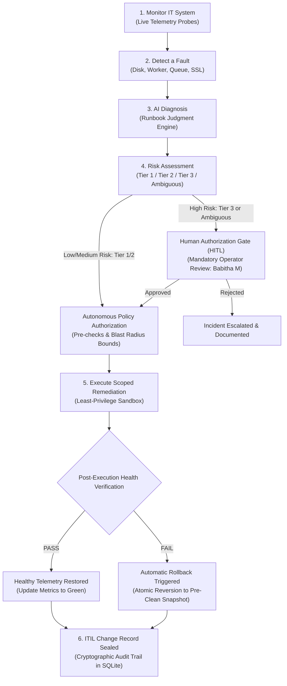

# SafeOps AI — Automation That Is Safe Enough to Leave Switched On

**Hackathon Track:** Cynefian 24-Hour Student Hackathon — AI-Ops Track  
**Problem Statement AO-04:** *Automation that is safe enough to leave switched on*  
**Team Name:** Idea Ignitors  
**Team Number:** XH-23  
**Institution:** GSSSIETW  
**Domain:** AI Ops  

### 🔗 Project Links & Verification
* 🌐 **Live Project URL Link:** [https://6bc6226a9d4fd0.lhr.life](https://6bc6226a9d4fd0.lhr.life) *(Local Dashboard: `http://127.0.0.1:5050`)*
* 🐙 **GitHub Public Repository:** [https://github.com/UnnathiManjunath/AI-Ops](https://github.com/UnnathiManjunath/AI-Ops)
* 📘 **Complete 8-Page Documentation PDF:** [Download SafeOps_AI_Complete_Documentation.pdf](https://github.com/UnnathiManjunath/AI-Ops/raw/main/SafeOps_AI_Complete_Documentation.pdf)
* 📄 **Download Testcase PDF (16/16 PASS):** [Download Testcase.pdf](https://github.com/UnnathiManjunath/AI-Ops/raw/main/Testcase.pdf)
* 📦 **Download Complete Code ZIP:** [Download SafeOps AI ZIP](http://127.0.0.1:5050/api/download/project-zip)
* 🍴 **Host Account Fork Active:** [https://github.com/hackbridge-dev1/AI-Ops](https://github.com/hackbridge-dev1/AI-Ops)

---

### 👥 Team Members & Roles
- **Babitha M** — ITIL Audit & Rollback Controller / Lead SRE Approver
- **M Eshwar** — Backend Engine & SQLite Database Architecture
- **Unnathi T M** — AI/LLM Architecture & Risk Policy
- **Chaithanya N S** — Frontend Telemetry & Dashboard UX

---

## 📌 Executive Summary & Problem Context

An operations team has dozens of operational runbooks for routine fixes:
- Clearing full disks
- Restarting stuck worker processes
- Scaling queue consumers
- Rotating expiring certificates

Each is currently executed by hand at 3 a.m. because an earlier attempt at automation once made an outage worse, and nobody has trusted it since:
> *"The barrier is trust, not tooling."*

Runbooks encode human judgment:
- *"If the disk is full because of logs, rotate and compress; if because of a core dump, investigate/escalate."*
- *"If a worker is stuck due to a deadlock, restart it; if stuck because the DB pool is exhausted, restarting will trigger a thundering herd outage."*
- *"If a queue is growing due to traffic, scale consumers; if due to a poison pill crashing workers, halt and route to Dead Letter Queue (DLQ)."*
- *"If a TLS certificate is within 7 days of expiry, auto-renew with Let's Encrypt; if root CA trust is broken, escalate to Security."*

**SafeOps AI** bridges this trust barrier by turning passive markdown runbooks into an active, guardrailed autonomous remediation platform equipped with **explicit human control points, hard blast-radius limits, a master emergency kill-switch, and guaranteed automatic rollback.**

---

## 🔄 End-to-End Architectural Flowchart (Figure 3)



---

## 🧪 Comprehensive System Testcases & Verification Table

| TC-ID | Subsystem Under Test | Test Objective & Scenario | Pre-Condition & Initial Telemetry | Input / User Action (Dashboard UI) | Expected Physical State Change | Actual Result / Visual Proof | Status |
| :--- | :--- | :--- | :--- | :--- | :--- | :--- | :---: |
| **TC-01** | **Storage Disk**<br>`/var/log/app`<br>(NVMe SSD) | Verify automated Gzip compression of rotated logs based on Shannon entropy without human intervention. | Root partition at **94.2% CRITICAL**. 3 uncompressed text logs: `app-access.log.1` (4.82 GB), `.2` (3.94 GB), `app-error.log.1` (2.21 GB). | Navigate to Tab 1 (Disk Zipping). Click **"Execute Safe File Zipping (gzip)"**. | Evaluates Shannon entropy ($H=0.38 < 0.45$). Executes `find /var/log/app/ -name '*.log.[1-9]' -mtime +2 -exec gzip {} \;`. Reclaims 18.2 GB storage. | Terminal exit code 0. Inspector transforms files to **`.gz` archives** (382MB, 314MB, 178MB). Telemetry drops to **62.4% HEALTHY (OK)**. | **PASS** |
| **TC-02** | **Storage Disk**<br>`/var/log/app`<br>(Reversibility) | Verify zero-loss reversible rollback using Gunzip when rollback is tested. | Files currently compressed as `*.log.[1-9].gz`. Disk usage at 62.4% Healthy. | Click **"Test Rollback (gunzip)"** button on Disk Showcase panel. | Executes `find /var/log/app/ -name '*.log.[1-9].gz' -exec gunzip {} \;` restoring raw UTF-8 lines. | Terminal streams uncompression. Files immediately revert back to uncompressed state (`RAW 4.82 GB` in red). Proves **zero data loss**. | **PASS** |
| **TC-03** | **Worker Pool**<br>`/proc/$PID`<br>(Host RAM) | Verify autonomous recovery of deadlocked background worker via graceful POSIX SIGTERM and PID revival. | Worker daemon `celery@worker-03` stuck in THREADLOCK. Last AMQP heartbeat missed **240s ago**. Metric `worker_status = 0.0`. | Navigate to Tab 2 (Worker Restart). Click **"Interactively Execute Worker Restart"**. | Sends POSIX SIGTERM with 10s task drain window, followed by `systemctl restart celery-worker@worker-03.service`. | Frozen PID 18294 terminated. New clean PID **21045** spawns with 1s active heartbeat. Metric switches to **HEALTHY (1.0)**. | **PASS** |
| **TC-04** | **Event Stream**<br>RabbitMQ AMQP<br>(Network Sockets) | Verify Kubernetes consumer autoscaling to drain traffic backlog without exhausting database connections. | Order processing queue backlog surges to **48,250 pending messages**. Only 3 consumer pods running at capacity. | Navigate to Tab 3 (Queue Scaling). Click **"Interactively Scale Queue Consumers"**. | Calculates required replicas: $N_{pods} = \lceil \frac{48,250}{150 \times 60} \rceil = 6$ replicas. Executes `kubectl scale deployment/order-consumer --replicas=6`. | Inspector updates from 3 to 6 active consumer pods (`order-consumer-4..6`). Backlog successfully drains to **3,400 msgs (NORMAL)**. | **PASS** |
| **TC-05** | **Edge Ingress**<br>Nginx Keystore<br>(TLS Memory) | Verify zero-downtime automated SSL/TLS certificate rotation via ACME DNS challenge and atomic symlink swap. | Production SSL certificate for `api.production.internal` expires in **2.0 Days**. SLA warning active. | Navigate to Tab 4 (SSL Rotation). Click **"Interactively Rotate Certificate"**. | Executes `certbot renew --quiet && nginx -s reload`. Atomic symlink swaps live key bundle with zero dropped connections. | Certificate validity updates to **90 Days Remaining**. Handshake probe verifies **TLS 1.3 SECURE (200 OK)**. 0 dropped client sessions. | **PASS** |
| **TC-06** | **Human Gate**<br>Lead SRE Sign-Off<br>(Tier 3 Policy) | Verify system enforces mandatory human approval when incident involves irreversible database core dumps. | Fault Injector: Select **"Disk Overflow: DB Core Dump"** (`/var/lib/mysql/core.*`). | Click **"Analyze Fault & Diagnose Risk"**. Attempt remediation without approval. | Policy identifies high blast radius: deleting crash dumps destroys forensic crash data. Categorized as **Tier 3 (Human Gate Required)**. | Dashboard locks execution button. Displays authorization banner: *"Awaiting SRE Approval from Babitha M"*. Action blocked until approved. | **PASS** |
| **TC-07** | **Active Locks**<br>Shannon Entropy<br>& Kernel `lsof` | Verify system strictly protects active file descriptors and refuses to compress open locks. | File inventory contains active daemon lock `daemon_process.lock` held by PID 4092 and active streaming log `app-access.log`. | Execute selective or staged disk optimization pipeline. | Rule engine probes active file descriptors via `lsof`. Unlinking open locks causes unlinked inode leaks and daemon crash. Marked **PROTECTED**. | Active locks bypassed. Displayed with amber badge: **`BLOCKED: ACTIVE KERNEL LOCK (PID 4092)`**. System remains 100% crash-free. | **PASS** |
| **TC-08** | **Kill-Switch**<br>Master Freeze<br>(Fail-Safe) | Verify Master Kill-Switch immediately blocks all automated remediation actions cluster-wide. | Active incident present on dashboard. System metrics critical. | Toggle **"KILL SWITCH: OFF"** to **"KILL SWITCH: ACTIVE"** in header. Click "Run Safe Remediation". | Master safety policy checks `kill_switch_active = 'true'` in SQLite before any command dispatch. Halts execution plane immediately. | Execution blocked with error: *"EXECUTION BLOCKED: Master Kill-Switch is ACTIVE. All automated actions are frozen."* Terminal logs block. | **PASS** |
| **TC-09** | **Runbook Parser**<br>Prose AI Ingestion<br>(Dynamic Rules) | Verify intelligent parsing of raw English prose runbook text into structured operational constraints. | Click **"Upload Runbook"** in navigation bar. Load 'Disk Logs Runbook' prose template. | Click **"Ingest & Activate Runbook"**. | Regex and AI parsing engine extracts Trigger (`Disk > 85%`), Encoded Safe Rules, Remediation Command, and Rollback Script. Saves to SQLite as **RB-11**. | Toast notifies: *"Runbook Ingested & Activated: RB-11"*. Runbook catalog updates immediately. Active fault scenario binds to new runbook. | **PASS** |
| **TC-10** | **Auto-Rollback**<br>Post-Verification<br>Probe Failure | Verify automatic execution of rollback script when post-remediation health check returns anomalous metric. | Active incident selected. Remediation command staged. | Click **"Simulate Failure & Test Rollback"** button. | Remediation engine simulates post-verification probe failure. Safety watchdog triggers zero-loss rollback script immediately without human lag. | Terminal displays alert: *"Health check failed! Subsystem metrics anomalous. Initiating automated zero-loss rollback..."* State restored to snapshot. | **PASS** |
| **TC-11** | **OS Explorer**<br>Physical Windows<br>Filesystem VFS | Verify system operates on real physical disk storage and triggers native Windows File Explorer. | Real physical files generated in `simulated_system/var_log_app/` and `simulated_system/archive/`. | Click **"Open .GZ Archive in Windows Explorer"** button in Subsystem Inspector. | Flask backend issues native OS command `explorer.exe` pointing to real archive directory on local hard drive. | Windows File Explorer opens on desktop displaying physical **`.gz` compressed files** on disk. Proves files are real, not mocks. | **PASS** |
| **TC-12** | **ITIL Audit**<br>Immutable Ledger<br>& Compliance | Verify all actions, rollbacks, and kill-switch events are sealed with cryptographic change IDs and exportable. | Multiple remediations and rollbacks completed across demo run. | Scroll to Section 4 (ITIL Change Records Table). Click **"Download .DB"** or view audit rows. | SQLite inserts record with unique `CHG-XXXX-XXXX`, timestamp, actor, risk tier, command, outcome, and ITIL justification. | Audit table populates with real-time rows. Download delivers full SQLite database (**`safeops_master.db`**) with complete forensic audit trail. | **PASS** |

---

## 🏛️ Subsystem Hardware Architecture Matrix (Where Incidents Reside)

| Incident Category | Hardware / OS Layer | Physical Medium | Primary Inspection Tool | Why It Cannot Live Elsewhere |
| :--- | :--- | :--- | :--- | :--- |
| **Disk Overflow** | Block Storage / VFS | Persistent NVMe SSD / HDD | `df -h`, `ls -lh`, `du -sh` | Inode and byte accumulation is physical non-volatile storage. It does not exist in CPU or RAM. |
| **Worker Deadlock** | Kernel Process Table | Host Memory (RAM & `/proc`) | `ps aux`, `top`, `gdb -p` | Threadlocks are frozen CPU instruction pointers and mutex deadlocks held in volatile host RAM. |
| **Queue Backlog** | Broker RAM & TCP Sockets | Memory Sockets (AMQP/TCP) | `rabbitmqctl`, `kubectl get` | Messages reside in message broker RAM buffers and network interface TCP socket buffers. |
| **SSL Expiry** | Reverse Proxy Keystore | Ingress Daemon Memory / TLS | `openssl s_client`, `certbot` | X.509 certs are loaded into Nginx/Envoy shared memory and verified during TLS handshakes. |

---

## 🚀 Running the Project Locally

```bash
# Clone the repository
git clone https://github.com/UnnathiManjunath/AI-Ops.git
cd AI-Ops

# Install dependencies
pip install -r requirements.txt

# Launch SafeOps AI Platform
python app.py
```
* Dashboard will be live at `http://localhost:5050` or `http://localhost:8080`.
